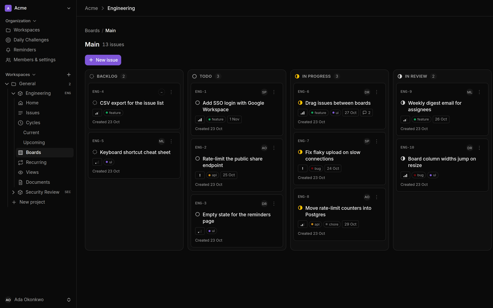
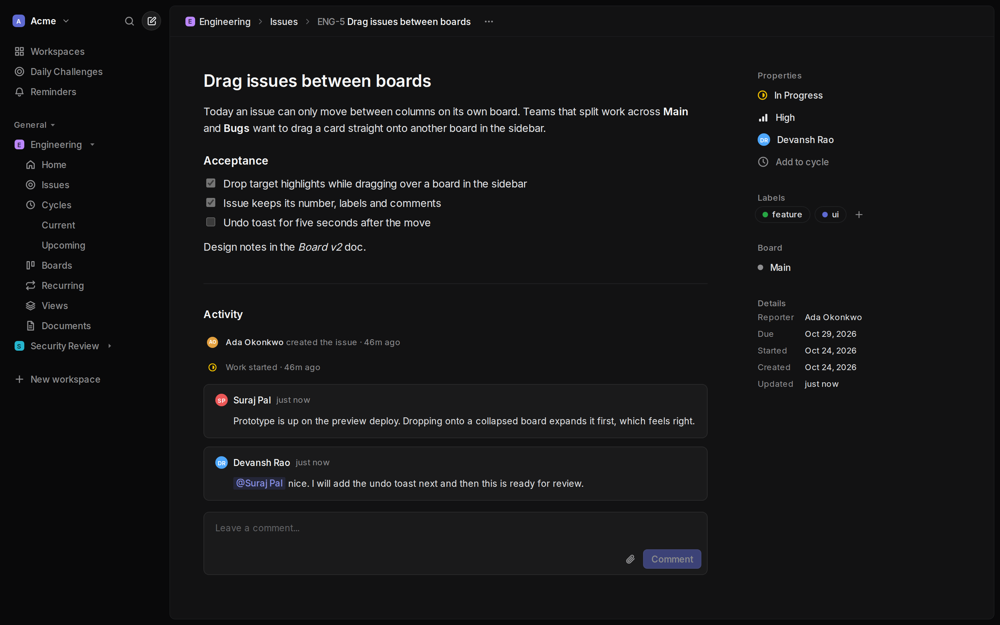

# Flone

**A small, self-hostable Kanban board for teams, with an MCP server built in so your AI assistant can work the board too.**

[](https://github.com/vedus-in/flone/actions/workflows/ci.yml)
[](LICENSE)
[](https://railway.com/deploy/flone)



## Features

- **Boards** with drag and drop, your own workflow states, priorities, labels, due dates and assignees
- **Issues** in Markdown, with checklists, comments, @mentions and pasted screenshots
- **Cycles, saved views, recurring tickets and reminders** (by email, or a phone call if you want one)
- **Documents**: nested Markdown pages per project, publishable by link
- **Organizations and workspaces** with Owner, Admin and Member roles and email invitations
- **MCP server and CLI**: 50 tools that let Claude, Cursor or any MCP client do what you can do in the UI
- **Keyboard-first interface**: a dense, Linear-style layout with a command menu, shortcuts for every common move, and light, dark or system themes
- **Easy to host**: one Next.js app and one Postgres database. Email through any SMTP server or Resend.



## Quick start

```bash
git clone https://github.com/vedus-in/flone.git && cd flone
cp .env.docker.example .env
# set POSTGRES_PASSWORD and CRON_SECRET (openssl rand -hex 24),
# and SMTP_HOST=mailpit, SMTP_PORT=1025 to try it with a local inbox
docker compose --profile mailpit up -d
```

Open [localhost:3000](http://localhost:3000) and register. The confirmation email lands in Mailpit at [localhost:8025](http://localhost:8025). The first account becomes the site administrator.

## Keyboard shortcuts

| Keys | Action |
| --- | --- |
| `⌘K` / `Ctrl+K`, `/` | Command menu: jump anywhere, create an issue, search, switch theme |
| `C` | New issue |
| `G` then `A` / `B` / `E` | Active issues, backlog, all issues |
| `G` then `V` / `C` / `K` / `D` | Current cycle, cycles, boards, documents |
| `J` / `K` | Move through an issue list, `Enter` to open |
| `S` / `P` / `A` / `L` | On an issue: status, priority, assignee, labels |
| `?` | Every shortcut |

## Deploy

- **Railway:** one click with the button above. It sets up the app, Postgres and the reminders scheduler.
- **Your own server:** Docker Compose behind any HTTPS proxy. See [Self-hosting](docs/self-hosting.md).

## Connect your AI assistant

Create a token under **MCP access** in the organization menu (top left, or `⌘K` → MCP access), then:

```bash
claude mcp add --transport http flone https://your-flone.example.com/api/mcp \
  --header "Authorization: Bearer <your-token>"
```

Every tool goes through the same permission checks as the web app. See [MCP access](docs/mcp.md) for all 50 tools and other clients.

## Docs

| | |
| --- | --- |
| [Self-hosting](docs/self-hosting.md) | Docker Compose, HTTPS, upgrades, backups, Railway |
| [MCP access](docs/mcp.md) | Tokens, clients, the full tool list |
| [Development](docs/development.md) | Stack, local setup, scripts and checks |
| [About Flone](docs/features.md) | Every feature in detail, and what is left out on purpose |
| [Security notes](docs/security.md) | What is implemented, and the known limits |
| [Data model](docs/data-model.md) | Tables and how tenancy is enforced |

## Contributing

Issues and pull requests are welcome. See [CONTRIBUTING.md](CONTRIBUTING.md) for setup and the checks CI runs, and [SECURITY.md](SECURITY.md) for reporting a vulnerability privately.

## License

[GNU AGPL v3](LICENSE). You can use, modify and self-host Flone freely. If you run a modified version as a service for other people, you must make your modified source available to them.
